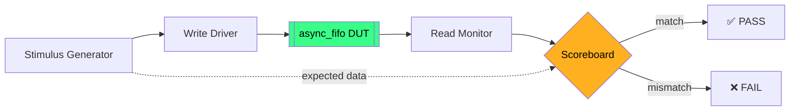

# Asynchronous_FIFO
<div align="center">



<a href="https://git.io/typing-svg"></a>

<br/>


</div>

---

## ✦ Overview

When two parts of a chip run on **different, unrelated clocks**, passing data directly between them is unsafe — signals can be sampled mid-transition and become **metastable**. An **asynchronous FIFO** solves this: the writer and reader each work in their own clock domain, and only carefully-prepared pointer values cross the boundary.

This project is a **parameterized asynchronous FIFO in Verilog RTL** using **Gray-code pointers** and **2-FF clock-domain-crossing synchronizers**, verified with a **self-checking testbench** (10,000+ transactions, 0 mismatches).

> 💡 *In one line: data goes in on `wclk`, comes out on `rclk`, and nothing is lost, duplicated or corrupted.*

---

## ✦ Highlights

| | Feature | Details |
|---|---|---|
| 🔧 | **Parameterized** | `DATA_WIDTH` and `ADDR_WIDTH` set the width and depth |
| 🔢 | **Gray-code pointers** | Only 1 bit changes per step → safe to cross clock domains |
| 🔁 | **2-FF synchronizers** | Pointers synchronized into the opposite clock domain |
| 🚦 | **Full / Empty flags** | Generated using N+1-bit pointers in their own domains |
| ✅ | **Self-checking testbench** | 10,000+ read/write transactions, **0 mismatches** |
| 🕒 | **5+ clock combinations** | Verified across different `wclk` / `rclk` frequency ratios |
| ⚠️ | **Corner cases** | Full, empty, overflow and underflow all exercised |

---

## ✦ System Architecture

<div align="center">

</div>

| Module | Domain | Job |
|---|---|---|
| `fifomem` | both | Dual-port memory: write on `wclk`, read on `rclk` |
| `wptr_full` | `wclk` | Write pointer (binary + Gray) and **full** flag |
| `rptr_empty` | `rclk` | Read pointer (binary + Gray) and **empty** flag |
| `sync_r2w` | `wclk` | Brings the read pointer safely into the write domain |
| `sync_w2r` | `rclk` | Brings the write pointer safely into the read domain |

---

## ✦ How It Works

### 1️⃣ Why Gray code?

<div align="center">

</div>

```verilog
// binary -> gray
assign gray_next = (bin_next >> 1) ^ bin_next;
```

### 2️⃣ Crossing the clock boundary

<div align="center">

</div>

```verilog
always @(posedge clk or negedge rst_n)
  if (!rst_n) {q2, q1} <= 0;
  else        {q2, q1} <= {q1, d};   // 2-FF synchronizer
```

### 3️⃣ Detecting Full and Empty

<div align="center">

</div>

```verilog
assign empty_val = (rgray_next == rq2_wptr);
assign full_val  = (wgray_next == {~wq2_rptr[ADDR_WIDTH:ADDR_WIDTH-1],
                                    wq2_rptr[ADDR_WIDTH-2:0]});
```

### 4️⃣ Write → Read behaviour

<div align="center">

</div>

---

## ✦ Verification

<div align="center">

</div>



### Clock-ratio coverage

<div align="center">

</div>

> ✏️ *Replace the labels above with your exact `wclk` / `rclk` frequency pairs.*

| Scenario | Checked |
|---|---|
| Write until **full**, then keep writing (overflow) | ✅ |
| Read until **empty**, then keep reading (underflow) | ✅ |
| Simultaneous read and write | ✅ |
| Reset in the middle of operation | ✅ |
| 10,000+ randomized read/write transactions | ✅ **0 mismatches** |

---

## ✦ Repository Structure

```text
async-fifo/
├── rtl/
│   ├── async_fifo.v        # top module
│   ├── fifomem.v
│   ├── wptr_full.v
│   ├── rptr_empty.v
│   ├── sync_r2w.v
│   └── sync_w2r.v
├── tb/
│   └── async_fifo_tb.v     # self-checking testbench
├── docs/images/            # diagrams used in this README
└── README.md
```

> Edit file names to match your actual project.

---

## ✦ Getting Started

**Requirements:** Xilinx Vivado (simulator included).

```bash
git clone https://github.com/Prathameshgirhe/<repo-name>.git
```

1. Open **Vivado → Create Project**, add everything in `rtl/` as design sources
2. Add `tb/async_fifo_tb.v` as a **simulation source** and set it as top
3. Run **Behavioral Simulation**
4. Check the Tcl console — the testbench prints the number of transactions and `0 mismatches` on success
5. Open the waveform window to see `wclk`, `rclk`, `full`, `empty`

### Parameters

| Parameter | Meaning | Default |
|---|---|---|
| `DATA_WIDTH` | Width of each word | `8` |
| `ADDR_WIDTH` | Depth = 2^ADDR_WIDTH | `4` |

---

## ✦ What I Learned

- Why metastability happens and how 2-FF synchronizers reduce the risk
- Why only **Gray-coded** values can safely cross clock domains
- Using **N+1-bit pointers** to tell full from empty
- Building a **self-checking** testbench instead of eyeballing waveforms

---

## ✦ Roadmap

- [ ] Add almost-full / almost-empty flags
- [ ] Constraint file + timing report for FPGA implementation
- [ ] SystemVerilog / UVM testbench
- [ ] Formal CDC checks

---

<div align="center">

### 👤 Author

**Prathamesh Girhe**
B.E. Electronics & Telecommunication · GCOEARA, Avasari Khurd

[](https://github.com/Prathameshgirhe)
[](https://linkedin.com/in/prathamesh-girhe-b6a09631a)

⭐ *If you like it, star it!*


</div>
